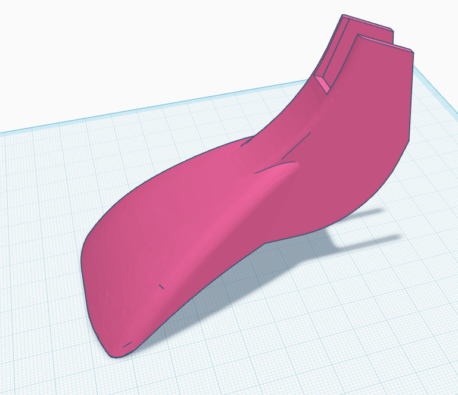

# Stepcraft CNC - Fräsvorlagen & STL-Dateien


<!-- featured-project-image -->
<p align="center"></p>
<p align="center"><sub>Amir Mobasheraghdam</sub></p>


Willkommen im **Stepcraft CNC** Repository! Hier finden Sie eine umfangreiche Sammlung von STL-Dateien und Fräsvorlagen, die speziell für die **Stepcraft CNC-Fräse** entwickelt wurden. Alle Dateien sind optimiert für die Verwendung mit der Stepcraft-Software und können direkt auf Ihrer Maschine verwendet werden.

## 📂 Inhalt des Repositorys

Dieses Repository enthält eine Vielzahl von STL-Dateien für verschiedene Anwendungen:

- **3D-Modelle** für Prototyping und Design
- **Dekorative Elemente** für Holz- und Kunststoffbearbeitung
- **Mechanische Teile** für den Maschinenbau
- **Schablonen und Vorlagen** für präzise Wiederholungen
- **Kunstprojekte** und kreative Designs

## 🔧 Kompatibilität

Alle Dateien wurden speziell für folgende Stepcraft-Modelle getestet und optimiert:

- Stepcraft 1
- Stepcraft 2
- Stepcraft 420
- Stepcraft 480
- Stepcraft 600
- Stepcraft D.840

Die Dateien sind im **STL-Format** (Standard Triangle Language) gespeichert, das von den meisten CAD-Programmen und Slicer-Software wie Cura, Simplify3D oder dem Stepcraft-eigenen Control-Software gelesen werden kann.

## 🚀 Verwendung

1. **Repository klonen oder herunterladen:**
   ```bash
   git clone https://github.com/Amirmobash/stepcraft.git
   ```

2. **STL-Dateien importieren:**
   Öffnen Sie Ihre bevorzugte CAM-Software (z.B. Stepcraft Control Software, Fusion 360, oder VCarve) und importieren Sie die gewünschte STL-Datei.

3. **Fräspfade generieren:**
   Erstellen Sie basierend auf Ihrem Material und Fräser die entsprechenden Werkzeugpfade.

4. **Fräsen:**
   Übertragen Sie das Programm auf Ihre Stepcraft CNC-Fräse und starten Sie den Fräsvorgang.

## 📋 Voraussetzungen

- Stepcraft CNC-Fräse (oder kompatible Maschine)
- CAM-Software zur Pfadgenerierung
- Grundlegende Kenntnisse in der CNC-Bearbeitung
- Fräser entsprechend dem gewählten Material

## 🛠️ Empfohlene Einstellungen

| Material | Fräser | Vorschub | Drehzahl |
|----------|--------|----------|----------|
| Holz (weich) | 3mm Spiralnutfräser | 1000-1500 mm/min | 18000-20000 U/min |
| Holz (hart) | 3mm Spiralnutfräser | 800-1200 mm/min | 16000-18000 U/min |
| Kunststoff | 3mm Einschneider | 1200-1800 mm/min | 15000-18000 U/min |
| Aluminium | 3mm VHM-Fräser | 300-600 mm/min | 12000-15000 U/min |

*Hinweis: Die tatsächlichen Parameter können je nach Maschine und Material abweichen. Führen Sie immer zuerst Testfräsungen durch.*

## 📁 Verzeichnisstruktur

```
stepcraft/
├── 3d-models/           # Komplexe 3D-Modelle
├── decorative/          # Dekorative Elemente und Ornamente
├── mechanical/          # Mechanische Bauteile
├── templates/           # Schablonen und Vorlagen
├── projects/            # Komplette Projekte
└── assets/              # Vorschaubilder und Dokumentation
```

## 🤝 Beitragen

Beiträge zu diesem Repository sind willkommen! Wenn Sie eigene STL-Dateien für Stepcraft-Fräsen haben:

1. Forken Sie das Repository
2. Erstellen Sie einen Branch (`git checkout -b feature/NeueDateien`)
3. Committen Sie Ihre Änderungen (`git commit -m 'Füge neue STL-Dateien hinzu'`)
4. Pushen Sie den Branch (`git push origin feature/NeueDateien`)
5. Öffnen Sie einen Pull Request

## 📜 Lizenz

Dieses Projekt ist unter der MIT-Lizenz lizenziert - siehe die [LICENSE](LICENSE) Datei für Details.

## 📞 Kontakt

Bei Fragen, Anregungen oder Problemen können Sie gerne ein Issue eröffnen oder mich direkt kontaktieren.

---

**Viel Erfolg beim Fräsen!** 🎉
```
.
